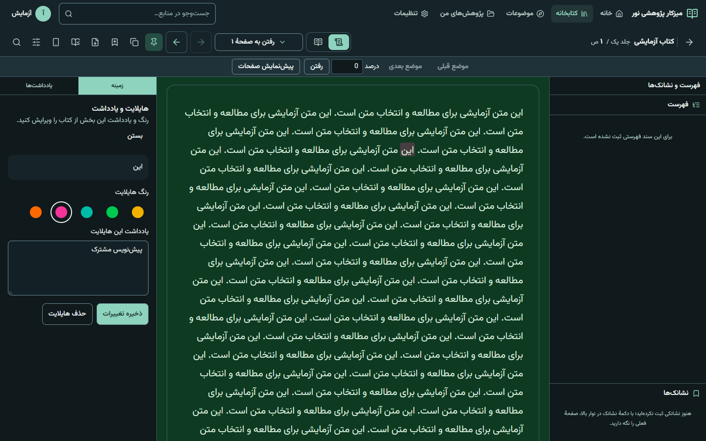

# هماهنگ‌سازی کتاب‌خوان موبایل و دسکتاپ

تاریخ بررسی: ۲۰۲۶-۱۰-۳۱. منطق مشترک در `use-reader-data` و hookهای `src/lib/reader` نگهداری می‌شود؛ نمایش و ژست‌ها متناسب با اندازهٔ صفحه باقی می‌مانند. تغییر پایگاه داده یا انتقال اجباری دادهٔ کاربر لازم نیست.

## ماتریس قابلیت و محل پیاده‌سازی

| فاز / قابلیت | منطق مشترک | دسکتاپ | موبایل | شاهد آزمون |
| --- | --- | --- | --- | --- |
| ۱: ایجاد، رنگ، یادداشت و حذف هایلایت | `useReaderAnnotations`، کش `annotations`، `Highlight.note` | جزئیات در پنل زمینه؛ زیر ۱۲۸۰ یا حالت متمرکز در Sheet | Sheet پایین صفحه | ذخیره/خطا/تلاش مجدد/بارگذاری مجدد/حذف، ساخت یادداشت از انتخاب |
| ۱: پیش‌نویس و درخواست در انتظار | editor بر اساس UID، نگهداری پیش‌نویس در تغییر چیدمان، جلوگیری از درخواست هم‌زمان | همان editor | همان editor | تغییر عرض ۱۴۴۰، ۱۰۲۴، ۷۶۸، ۴۱۲؛ تأیید خروج و مسدودشدن ذخیرهٔ تکراری |
| ۲: اشتراک دریافتی | `SharedReaderStatus` و `displayHlsByPage` | وضعیت و متن فقط خواندنی | همان وضعیت و هایلایت روی متن | اشتراک معتبر/منقضی و کنترل‌های ویرایش غایب |
| ۲: نشانک | کش `reader-bookmarks`؛ حذف پس از موفقیت API | فهرست و دکمهٔ صفحه | حذف مستقل از پرش به نشانک | خطای حذف و تلاش مجدد، موضع ثابت |
| ۲: اصلاح صفحه و نشانی | پیام اصلاح در `PageRenderer`؛ `readerAddressText` | روی همان صفحه | روی همان صفحه | پیام اصلاح در هر دو پوسته |
| ۳: جست‌وجو | عبارت، دامنه، فاصله، نتیجهٔ فعال، درخواست لغوپذیر در `useReaderData` | انتخاب جلد/اثر و فاصله | همان گزینه‌ها، دامنه فقط در اثر چندجلدی | درخواست یکسان و حفظ گزینه‌ها هنگام تغییر عرض |
| ۳: تطبیق بدون فاصله | `spacing.go` با نگاشت آفست code point؛ اسکن محدود جلد/اثر | نتایج سرور | نتایج سرور، بدون تطبیق محلی اضافه | Go: نیم‌فاصله، NBSP، اعراب عربی، مرز واژه، ویرگول و پاراگراف، دامنه، کش و نشست |
| ۳: تاریخچه و مقصد | `navigation.ts`، حداکثر ۵۰ موضع در sessionStorage همان تب | عقب/جلو، درصد و پیش‌نمایش صفحات | عقب/جلو و کنترل‌های لمسی موجود | پیش‌نمایش بدون پرش، انتخاب مقصد، بازگشت پس از تغییر عرض |
| ۴: تنظیمات و موضع منطقی | ترجیحات مشترک، سند/صفحه/بلوک/آفست؛ مواضع قدیمی قابل خواندن | فونت، فاصلهٔ پاراگراف، تراز، جهت، تمام‌صفحه | همان تنظیمات متن | ذخیرهٔ آفست، تغییر عرض و تراز؛ بارگذاری فونت‌های محلی |
| ۴: تنظیمات وابسته به نمایشگر | عرض ستون دسکتاپ مستقل از `mobile_reader` | عرض ستون؛ حالت متمرکز جدا از fullscreen | حاشیه، قفل، ژست، دستگیره، ناحیهٔ لمس مرکز ۴۵٪ | پیش‌فرض و شفافیت هنگام تنظیم، نبود چرخش، نگه‌داشتن قفل |
| ۵: PDF | `PdfReader` و صفحه‌بندی مشترک | ابزار فاقد متن پنهان | جست‌وجوی متن غیرفعال، یادداشت انتخاب متن غایب | فایل PDF آزمایشی، چهار عرض |

یادداشت عمومی صفحه و روایت همچنان از یادداشتِ هایلایت مستقل‌اند. پاک‌کردن فیلد یادداشت و ذخیره، هایلایت را نگه می‌دارد. حذف هایلایتِ دارای یادداشت با پیام صریح حذف هر دو تأیید می‌شود. عملیات ساخت، UID موقت را با UID پاسخ سرور جایگزین می‌کند.

## قرارداد افزوده‌شده

- `POST /search`: فیلد اختیاری `ignore_spacing` با پیش‌فرض `false`؛ فقط حالت `normalized_phrase` در دامنهٔ `document` یا `work` با شناسهٔ مشخص. مقدار در کلید کش و JSON نشست لحاظ می‌شود. فاصلهٔ معمولی، NBSP و نیم‌فاصله حذف می‌شوند؛ نشانه‌گذاری و مرز پاراگراف باقی می‌مانند. تطبیق جدید املایی/معنایی فعال نمی‌شود. آفست‌ها به متن اصلی برمی‌گردند. مسیر FTS5 از پیش‌فیلتر واژه‌ای عبور نمی‌کند؛ آداپتور OpenSearch برای این گزینه از اسکن محدود موتور محلی استفاده می‌کند. سقف نتیجه و وضعیت ناقص‌بودن قبلی حفظ می‌شود.
- `PUT /workspace/position`: علاوه بر `page_uid` و اطلاعات قدیمی، `document_uid`، `block_id` و `offset_cp` ذخیره می‌شود. `sub` صرفاً جزئیات صفحه‌بندی است. تغییر اندازه تنظیمات را بازنشانی نمی‌کند.

## اجرای آزمون

```powershell
npx tsc --noEmit
npx playwright test tests/e2e/reader-mobile-interactions.spec.ts --project=mobile
go test ./internal/search -run 'TestSpacing|TestFTS5IgnoreSpacing' -count=1
$env:NOOR_NEXT_DIST_DIR='.next-reader-verified'
$env:NODE_OPTIONS='--max-old-space-size=2048'
npx next build --webpack
```

نتیجهٔ نهایی: هر ۱۴ آزمون در توسعه (۴۷٫۶ ثانیه) و هر ۱۴ آزمون روی build تولید (۳۰٫۲ ثانیه) پاس شدند. TypeScript و ESLint فایل‌های مرتبط بدون خطا بودند؛ build تولید و کامپایل API موفق شدند. آزمون‌های اختصاصی فاصله، بستهٔ `norm` و بستهٔ `httpapi` پاس شدند.

آزمون گستردهٔ `go test ./internal/search ./internal/norm ./internal/httpapi -timeout 3m` کاملاً سبز نشد: تعدادی آزمون جست‌وجو در پاک‌سازی فایل SQLite موقت روی Windows خطای فایل باز داشتند؛ زیرآزمون `TestFTS5EngineEndToEnd/titles` نمایهٔ ناموجود گزارش کرد؛ `TestGoldenSetLocal` هنگام بارگذاری دادهٔ fixture پس از سه دقیقه timeout شد. این نتایج به‌عنوان پاس ثبت نشده‌اند. آزمون‌های اختصاصی این تغییر پس از آخرین اصلاح دوباره پاس شدند.

آزمون‌های مرورگر APIهای تغییردهندهٔ داده را شبیه‌سازی می‌کنند و به هایلایت‌ها یا نشانک‌های واقعی کاربر دست نمی‌زنند. آزمون‌ها در Chrome با ورودی لمسی شبیه‌سازی‌شده اجرا شده‌اند. بررسی بصری کتاب واقعی در مرورگر داخلی نیز انجام شده است.



## کارایی و حدود شواهد

| نمونهٔ ۹۰ فریم، پس از آماده‌شدن فونت‌ها | میانگین فاصلهٔ فریم | فریم بالای ۵۰ms | رندر مجدد متن هنگام اسکرول |
| --- | --- | --- | --- |
| مبنای توسعه، پیش از این تغییرات | ۶٫۹۵ms | ۰ | ۰ |
| توسعه، پس از تغییرات | ۶٫۹۶ms | ۰ | ۰ |
| build تولید نهایی، Webpack | ۶٫۹۵ms | ۰ | در build تولید قابل اندازه‌گیری با hook توسعه نیست |

این اعداد از همان fixture بلند و محیط headless کامپیوترند؛ نرخ تازه‌سازی محدود به ۶۰Hz نیست و این آزمایش اثبات روانی لمس روی تلفن نیست. در توسعه، شمارندهٔ commit واقعی React نشان داد اسکرول داخل صفحه، `PageRenderer` را دوباره رندر نمی‌کند. مبنای اولیهٔ build تولید با Turbopack به محدودیت حافظه برخورد کرد؛ بنابراین مقایسهٔ تولیدِ قبل/بعد روی کتاب واقعی در دسترس نیست. build تولید نهایی با Webpack موفق شد. نوسان بار سیستم و اسکرول برنامه‌ای در این نمونه لحاظ شده، ولی اندازه‌گیری جامع کار همگام و لمس واقعی محسوب نمی‌شود.

**انجام‌نشده به دلیل نبود دستگاه:** آزمون لمس واقعی روی Android Chrome و iOS Safari. شبیه‌سازی Chrome جایگزین این دو آزمون پذیرش نیست. ارزیابی نهایی هدف ۱۶٫۷ms و اینرسی، تغییر جهت انگشت، باز/بسته‌بودن نوارها و بارگذاری در دستگاه واقعی همچنان لازم است.
